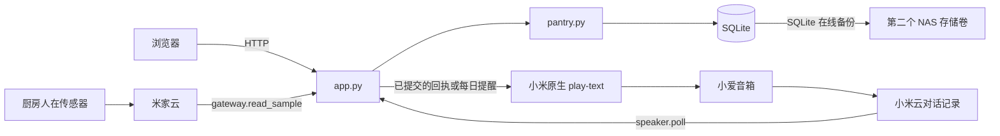

# 家庭库存服务维护手册

交接基线为 2026-11-01。先按「本地开发」启动独立实例，再用[接口手册](API.md)走一遍入库、查询、扣减和撤销。要评估换库存后台或添加条码、语音客户端，见[同类项目与复用路径](PROJECTS.md)。

## 运行在哪里

库存保存在部署主机的 SQLite 数据库，浏览器与音箱共享这份库存。默认启用家庭网页。选配 XiaoMusic 后支持 OH2P 音箱（已验证原厂固件 1.62.2），再指定厨房人在传感器可启用择机播报。



## 改什么，看哪里

| 文件 | 入口 | 修改场景 |
| --- | --- | --- |
| [pantry.py](../pantry.py) | `initialize / natural_voice / command / interpret / save_entries / change / undo` | 数据迁移、中文指令、批次增减、多轮追问、撤销。 |
| [pantry.py](../pantry.py) | `take_location / query_location / at_location / date_status / due_items` | 存放位置解析、按位置查询、到期规则。 |
| [app.py](../app.py) | `main / Handler / voice_step / reserve_summary / presence_loop` | 进程入口、HTTP 校验和认证、语音收件、提醒决策和发送顺序。 |
| [speaker.py](../speaker.py) | `_target / poll / speak / audibility` | 确认目标音箱、读取对话、原生播报、检查设备属性。 |
| [gateway.py](../gateway.py) | `_MiCloud / interpret / read_sample / cloud_post` | 米家登录和签名、厨房设备识别、判断人在状态及数据新鲜度。 |
| [page.html](../page.html) | `refresh / renderRows / mutate / edit` | 页面、位置和状态筛选、表单、请求重试。页面直接由后端提供，无前端构建步骤。 |
| [backup.py](../backup.py) | `backup_database / start_backup_worker` | 在线备份、完整性检查、按天保留快照。 |
| [compose.yaml](../compose.yaml)、[设备配置](../compose.xiaomi.yaml)、[Dockerfile](../Dockerfile) | Web 进程、持久卷、可选米家接入 | 自托管、配置、健康检查。 |

| [test_pantry.py](../test_pantry.py) | `HouseholdTests` | 临时 SQLite、模拟音箱输入、跨批次/位置边界、迁移和每日去重。 |

## 数据模型与不能破坏的约定

| 表 | 关键字段 | 语义 |
| --- | --- | --- |
| batches | id, name, qty, unit, due, kind, location, produced_on, shelf_value, shelf_unit | 每次入库新增一批，可同名同日。qty 是整数。零余量保留供撤销，普通查询只返回正余量。生产信息为空或零时表示日期来自直接录入。 |
| products / product_keys | 标准名、默认单位与位置 / 唯一匹配键、原写法、键类型、标准名 | 家庭商品字典；别名和条码只解析商品身份，不能标识库存批次。 |
| changes | id, before_json, after_json, undone, action, created_at | 一次业务变更对应一条前后快照，可包含多批。新增记录区分入库、使用、丢弃、改期、改位置及推迟查看。旧记录保留为 legacy，避免误判历史丢弃原因。撤销先比较当前批次与 after，再恢复 before。 |
| turns | id 主键, reply | 已完成请求及原答复。Web 写入共用 `web:` 命名空间，音箱使用 `voice:`。同 ID 重试不会再扣库存或再次发声。 |
| pending | channel 主键, body, until | 保存某个会话等待补日期或选批的上下文。180 秒后失效。 |
| settings | key 主键, value | 同时保存家庭设置、各会话最近批次、最近语音变更和跳过当天提醒等运行状态。值以字符串保存。 |
| notices | day 主键, state, detail | 每个上海自然日最多预留一次主动播报。detail 保存当次提醒文字，状态 API 只返回日期和状态。 |

- `expiry` 是到期日，`check` 是查看日，`stock` 仅记数量且 `due=""`。到期和查看的日期保存为 ISO 日期。查看日可以早于今天，仍然是「待查看」。
- `location=""` 表示未指定，结构化录入接受自定义位置。查「家里」包含未指定位置，查「冰箱」包含冰箱本身及明确登记的冷藏室、冷冻室。传感器安装在哪个房间，与商品放在哪里相互独立。
- `transact` 用 `BEGIN IMMEDIATE` 将查重、修改和写入回执放进同一事务。中文解析另有保存点。新增批次、改位置或扣减应复用这些入口，直接写 SQL 会绕过撤销或查重。
- 新字段既要迁移现有表，也要兼容历史 JSON。位置字段就是一个例子，旧库升级时填空串，撤销读取旧快照也补同样的默认值。详见 `initialize`、`undo` 和旧版本迁移测试。
- 同商品原有数量按本次入库前的余量计算。不同单位分开，不能把“一盒”和“一瓶”合成两个同单位物品。普通回执只在提交成功后发。Web 撤销是全家最近一次操作，音箱撤销还会核对最近变更是否仍是语音操作。

## 设备适配契约

**语音输入。** `speaker._target()` 向 XiaoMusic 的 `GET /device_list` 取设备信息，以 OH2P 和配置的 MIoT DID 匹配唯一音箱。MiNA deviceID 用于对话 Cookie，MIoT DID 用于播报，两者不可互换。NAS 只读挂载已有 XiaoMusic 登录文件。

`speaker.poll(since_timestamp)` 收 Unix 秒数，返回按时间排序的 `{id,text,ts}`。它读取小米云 `/device_profile/v2/conversation`，首页不带 timestamp，历史页用 nextEndTime。设备记录优先使用 requestId，缺失时用时间与文本生成摘要。云端时间为毫秒，适配器统一转换为秒。Web 手册中的 HTTP 接口由本项目维护，此处的小米接口随上游变化。

`voice_step` 只处理近期、符合库存意图的发言，按发言时的上海日期解释「明天」。健康时一轮结束后等 1 秒，失败后依次等 30、60、120、240 秒。重启最多回看约 120 秒，并以首次安装时间为下限。这个窗口之外的漏报不会自动补录。解析采用中文规则，扩充说法时需同时检查 `natural_voice` 的准入和 `interpret` 的实际动作。

**音箱输出。** `speaker.speak(text)` 通过 `gateway.cloud_post("/miotspec/action", ...)` 给目标音箱发送 `siid=7, aiid=3, in=[text]`。核对返回 DID 和设备码 0 后视为受理。超时没有可靠播放结果，当前代码不会补发。原厂音箱可能先说自己的回答，家庭已现场听到随后播出的「已记录」。这套接法保留原厂固件。

**厨房有人。** `read_sample()` 返回 occupied（True/False/None）、updated_at、duration_minutes 和诊断原因。型号为 `xiaomi.sensor_occupy.03`，从 `/miotspec/prop/get` 读取服务 2 下的属性 1078（有人状态）、1081（持续有人）、1082（持续无人）。使用设备上报时间，超过 180 秒、时间在未来或状态冲突都按未知处理。更换传感器型号时需要重新核对属性和值，不可只换 IP。

**主动提醒。** `presence_loop` 每轮约等 15 秒。成功、失败或没有新鲜上报都会经过 `reminder_status`，首页也用同一函数解释决策；查询入口不作预留。它检查开关、允许时段、跳过日期、待处理批次及人在信号（最长 180 秒，连续有人满 2 分钟）。时段内、当天尚未预留时，将最近检查写入 settings.window_check；同一分钟内相同结果不重复写。它不代表全天逐条日志，服务停机、升级之前无法回填。全部条件成立则先在事务中写当天预留，提交后播报，最后保存结果。崩溃或超时后可能少报一次，这个次序可以避免重启后重播。当日汇总最多展开五批。

## 本地开发

建议用 Python 3.11 或更高版本。这里的应用和测试只用标准库。从项目根目录执行：

```powershell
python -X utf8 -m unittest -v
```

要调网页和 HTTP 接口，可在 PowerShell 粘贴下面整段。它启动与生产相同的 Handler，用临时数据库、固定的本地演示码及回环地址，只启用 Web 服务。这样调「明天到期」时不会唤醒家里的音箱。浏览器打开输出的测试地址，按 Ctrl+C 结束后临时目录自动清理。

```powershell
@'
import tempfile
from pathlib import Path
from contextlib import closing
import app, pantry
with tempfile.TemporaryDirectory() as scratch:
    app.DB = Path(scratch) / "pantry.sqlite3"
    app.TOKEN = "local-demo-only"
    with closing(pantry.connect(app.DB)) as db:
        pantry.initialize(db)
    with app.ThreadingHTTPServer(("127.0.0.1", 18768), app.Handler) as server:
        print("http://127.0.0.1:18768/#token=local-demo-only", flush=True)
        try:
            server.serve_forever()
        except KeyboardInterrupt:
            pass
'@ | python -X utf8 -
```

验收建议按顺序做：同名商品在橱柜和冰箱各建一批，按位置查，扣减其中一批，再撤销。重放相同请求 ID 要得到同一答复和相同余量。分别覆盖到期日、查看日、无日期、跨午夜与厨房无人。最后用真实音箱核对云记录、库存和现场的声音。自动测试不覆盖小米账号过期或固件更新后的真实设备行为。

## 部署与恢复

| 环境变量 | 作用 |
| --- | --- |
| PANTRY_HOST / PANTRY_PORT | 监听地址和端口。直接运行默认 127.0.0.1:8768。容器内监听所有接口，宿主暴露地址由 PANTRY_BIND_IP 决定。 |
| PANTRY_DATA_DIR / PANTRY_BACKUP_DIR | 数据目录和备份目录。Compose 分别使用 /data 和 /backup 持久卷。直接运行默认保存在项目 data 目录，只有指定备份目录才启动备份线程。 |
| PANTRY_TOKEN | 可提供自己的家庭访问码，否则服务首次启动生成 web.token。此文件不属于数据库备份。 |
| XIAOMUSIC_URL / XIAOMUSIC_DID | 容器可达的 XiaoMusic URL、目标音箱 MIoT DID。未配置 URL 时只运行网页。 |
| XIAOMUSIC_TOKEN_PATH | Compose 宿主侧文件绝对路径。容器需有读取权限。两个适配器通过 XIAOMUSIC_TOKEN_FILE 和 XIAOAI_MI_TOKEN_FILE 指向同一只读文件。 |
| XIAOAI_KITCHEN_DID | 可选。设置后运行厨房传感器轮询。开启语音但不配置此项时，只响应用户主动指令。 |

1. 依照 [README](../README.md) 先启动 Web 模式，使用 /health 和登录后的 /api/state 验证。接设备时指定 Compose 的两个 -f 参数，保留同一项目名称和数据卷。
2. 发布更新前记录当前提交，备份数据并运行单元测试，然后运行 docker compose up -d --build。带设备时重复使用原来的 -f 组合。只改文档无需更新容器。
3. 回退时选择已验证且兼容当前数据库的提交，重建并检查健康和业务状态。正式切换数据前先在副本上试迁移。

4. 日常备份使用 SQLite 在线备份和 `PRAGMA quick_check` 后原子替换，每 15 分钟覆盖当天快照，按日期保留 14 天。它备份库存库，不含家庭访问码和小米登录文件。改结构前，另存一个不会被当天定时任务覆盖的命名快照。
5. 恢复数据前先把候选快照复制到临时目录，在副本上跑 `PRAGMA quick_check`、查看最新批次和 `notices` 日期。选定恢复点后停容器，完整保留原数据目录（含存在的 WAL/SHM），再把健康快照放进干净的数据目录并保留原 `web.token` 和文件属主。启动匹配版本，核对状态及批次数量。旧 WAL/SHM 不应与恢复的主库混用。恢复到早于今日播报的快照可能丢失去重记录，恢复时应先检查当天提醒设置。

### 怎么定位故障

| 症状 | 先检查 | 下一步 |
| --- | --- | --- |
| 页面能开，手机一直要求登录 | 家庭 Wi‑Fi、带登录片段的家庭链接 | 在宿主机按 README 取得本实例的家庭访问码，登录后再复制家庭链接。 |
| 小爱回答了，清单没有新增 | `devices.voice` 中查询时间与云端最近发言，米家该台音箱的对话记录 | 云端也缺这句时，查设备联网和账号。云端有但未入库时，按原话在临时库分别检查意图筛选和解析。 |
| 入库了但没听到确认 | `devices.output`、目标 DID、原生播报的返回值 | 单独核对实际出声。不要用重复入库指令来验证音量。 |
| 厨房有人，今天没提醒 | `settings`、`notice`、在库状态、传感器最近一次上报和持续分钟数 | 未达持续时间、已经预留、时段外或无临期批次都不会出声。厨房长时间没有新报告时显示未知。 |
| 登录更新后设备全部中断 | XiaoMusic 是否能列出该台音箱、只读挂载是否仍指向当前登录文件 | 若宿主文件被删除后重建，重新部署以刷新单文件挂载。排障输出不要包含 Cookie、访问码或签名 URL。 |

## 后续扩展从哪里切入

- **条码与商品主档。** [catalog.py](../catalog.py) 的 save/lookup/listing 管理本地字典；匹配键做 Unicode NFKC 和大小写归一化。save_entries 在写批次和生成回执前统一解析键。语音查询和扣减用 expand_query 展开别名；历史库存不因编辑字典而改名。键冲突和重试由同一写事务处理。将来接摄像头或外部商品库时，只需传条码到查找入口，仍由用户确认本批日期。
- **生产日期与多商品。** shopping_pieces 只在明确边界拆句；共用日期必须说「都」。add 解析所有条目后才调用一次 save_entries，整句话只产生一条 changes 记录，撤销也以整句为单位。shelf_fields 是服务端日期算法；改算法时同步检查网页预览与跨闰日/月末用例。没有年份的生产日期按当年处理；跨年请显式说年份。用完整 SQLite 备份保留商品字典、历史与待办；CSV 不是恢复备份。
- **增加语音说法。** 先把原话写成回归用例，同时提供一个相似但不应记账的句子。对缺日期、多批同名或单位不一致的情况沿用追问，不猜生产日期或食品安全期。
- **增加提醒条件。** 若以后用手机判断家里是否有人，应新增带观测时间的信号。先定义“在家”和“在厨房”分别允许何时播报，再在 `presence_loop` 组合信号。所有触发都走同一 `reserve_summary`，否则多个来源可能同天重复播报。
- **更换库存后端。** 先决定谁是唯一写入方，映射商品、位置、批次和单位，再处理查重、撤销、查看日及上海日期边界。目前业务层直接使用 SQLite，没有已经实现的 Grocy 适配器。可先对比只读库存结果，再切换写入。

实机已核对语音入库和原生回执。位置筛选、跨位置扣减、网页操作及旧库迁移有隔离测试。首次由真实临期库存和厨房有人同时触发的主动提醒，截至此前现场验收仍待确认。
